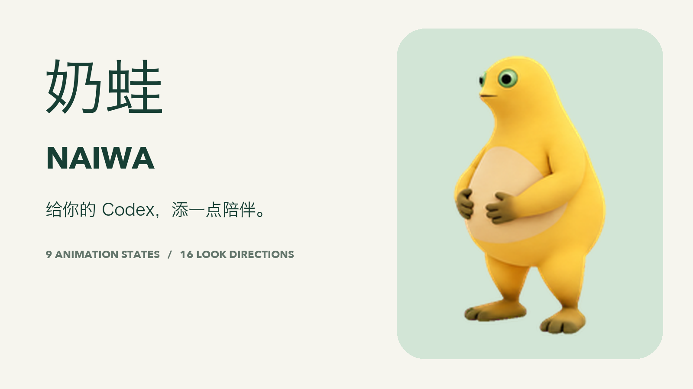

# Naiwa · A little company for your Codex



Naiwa (奶蛙) is a golden, green-eyed animated companion. **9 animation states, 16 look directions, 73 frames.**

[Adopt Naiwa](https://chatgpt.com/s/sharepet_6ae4aa47fa508191b009739633003af2) · [Download ZIP](https://github.com/Jekyll-Chan/naiwa-codex-pet/archive/refs/heads/main.zip) · [中文说明](README.md)

Download and extract this repository, then run:

```bash
python3 scripts/install.py
```

On Windows, use `py scripts/install.py`. The installer has no dependencies or network access; it checks the sprite checksum and refuses to overwrite an existing install unless `--replace` is supplied.

Open **Settings → Pets**, refresh custom pets, and choose **奶蛙 Naiwa**. Use `/pet` to show the companion. Alternatively copy `pets/naiwa/` into `${CODEX_HOME}/pets/` (default `~/.codex/pets/`). Availability varies by client/workspace. See [official Pets documentation](https://learn.chatgpt.com/docs/pets).

The package contains a v2 **1536 × 2288** transparent PNG with **192 × 208** cells. Keep `spriteVersionNumber: 2` in `pet.json`.

The nine states are idle, move right, move left, wave, jump, failure, waiting for input, active thinking, and review. Active thinking is stationary, not locomotion. The final two rows contain the clockwise sixteen-direction gaze loop.

[All-state contact sheet](media/all-states.png) · [Animation GIFs](media/animations/) · [TikTok campaign](media/tiktok/)

Promotional desktop scenes are clearly labeled illustrations, not app recordings. Character animation is based on the release sprite; the promotional video adds smoothing and eased transitions. This independent community project changes appearance, not model behavior.

Code: MIT. Artwork usage: [ASSETS.md](ASSETS.md).

The minimal promotional video is 30 seconds at 60fps, with no QR codes or in-scene labels.
