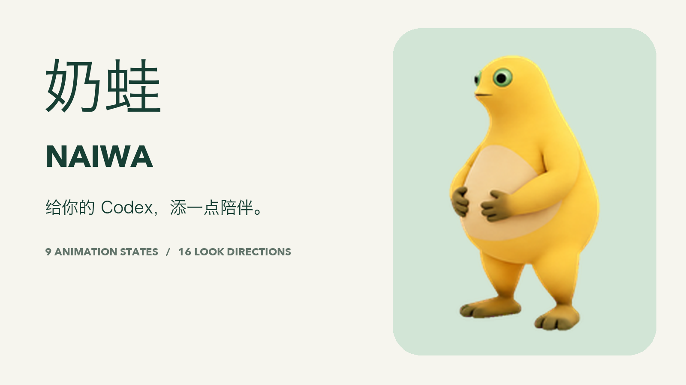
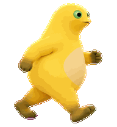
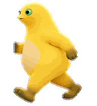

# 奶蛙 Naiwa · Codex Pet

**给你的 Codex，添一点陪伴。**  A little company for your Codex.



金黄色身体、绿色大眼睛，还有一点慢半拍的可爱。奶蛙会陪你发呆、等待、思考、检查，也会在开心时跳起来。

**9 种动画状态 · 16 个注视方向 · 73 帧 · v2 透明精灵图**

[直接领养奶蛙](https://chatgpt.com/s/sharepet_6ae4aa47fa508191b009739633003af2) · [下载项目 ZIP](https://github.com/Jekyll-Chan/naiwa-codex-pet/archive/refs/heads/main.zip) · [完整形态图](media/all-states.png) · [TikTok 宣传图组](media/tiktok/)

## 安装到桌面端

### 方式一：领养链接

打开上面的「直接领养奶蛙」，在支持 Pets 分享的账户中领取。然后在 **Settings → Pets** 选择奶蛙。分享功能和可用入口取决于客户端与工作区。

### 方式二：本地安装包

1. 下载本仓库 ZIP 并解压，或克隆本仓库。
2. 在项目目录运行：

   ```bash
   python3 scripts/install.py
   ```

   Windows 可以运行 `py scripts/install.py`。安装器只复制本仓库内的两个文件，不访问网络，也不需要第三方 Python 包。它会先校验精灵图的 SHA-256，且默认不覆盖已有的奶蛙。

3. 打开 **Settings → Pets**，刷新并选择 **奶蛙 Naiwa**。输入 `/pet` 显示桌面伴侣。

安装位置为 `${CODEX_HOME}/pets/naiwa/`，未设置 `CODEX_HOME` 时使用 `~/.codex/pets/naiwa/`。也可以手动把仓库中的 `pets/naiwa` 文件夹复制到该位置。

更新已有安装：`python3 scripts/install.py --replace`。卸载时移除安装位置中的 `naiwa` 文件夹即可。

### 方式三：应用安装链接

支持该功能的客户端可使用以下 v2 安装链接。完整复制到浏览器地址栏，或在 macOS 终端用 `open '链接'` 打开：

```text
codex://pets/install?name=Naiwa&imageUrl=https%3A%2F%2Fraw.githubusercontent.com%2FJekyll-Chan%2Fnaiwa-codex-pet%2Fmain%2Fpets%2Fnaiwa%2Fspritesheet.png&description=A%20little%20company%20for%20your%20Codex.&spriteVersionNumber=2
```

入口随客户端版本有所变化；如果链接没有响应，使用本地安装方式。安装链接字段依据 [官方 Commands 文档](https://learn.chatgpt.com/docs/app/commands)，桌面端操作依据 [官方 Pets 文档](https://learn.chatgpt.com/docs/pets)。

## 奶蛙的全部形态

| 状态 | 作用 | 帧数 | 动画 |
| --- | --- | ---: | --- |
| 待机 Idle | 呼吸、眨眼，安静陪伴 | 6 |  |
| 向右移动 | 拖动时向右小跑 | 8 |  |
| 向左移动 | 拖动时向左小跑 | 8 |  |
| 挥手 Waving | 打个招呼 | 4 |  |
| 跳跃 Jumping | 起跳、腾空、落地 | 5 |  |
| 失败 Failed | 失落后恢复 | 8 |  |
| 等待 Waiting | 等待批准、帮助或输入 | 6 |  |
| 工作 Running | 专注思考，脚步保持不动 | 6 |  |
| 检查 Review | 检查完成的工作 | 6 |  |

**16 向注视**：上 → 右上 → 右 → 右下 → 下 → 左下 → 左 → 左上，按 22.5° 步进。


## 项目内容

```text
pets/naiwa/       可直接安装的 pet.json + spritesheet.png
media/           动画、总览图、封面
media/tiktok/    7 张竖版宣传图、30 秒视频与发布文案
scripts/         安装、校验、宣传素材生成脚本
docs/            版本与质量说明
```

图组中的桌面场景是**使用效果示意，不是 Codex 界面实录**。状态动画和注视动画基于发布包中的真实精灵图，宣传视频另作平滑与转场处理。动画由宿主应用触发；该项目不修改模型能力。

## 开发与验证

普通安装无需依赖。验证或重建宣传素材时：

```bash
python3 -m venv .venv
# macOS / Linux
source .venv/bin/activate
pip install -r requirements-dev.txt
python scripts/validate.py
python scripts/render_media.py
```

Windows 使用 `.venv\Scripts\activate`。渲染脚本默认使用 macOS 字体；其他系统通过 `NAIWA_FONT` 指向支持中文的字体文件、`NAIWA_LATIN_FONT` 指向拉丁字体文件。

代码采用 MIT 许可；角色图像、动画及其衍生宣传素材的使用范围见 [ASSETS.md](ASSETS.md)。这是独立社区项目。

宣传视频采用简洁的 60fps 竖屏版本，无二维码。直接重建：`python scripts/render_minimal_video.py`。可用外部 [RIFE ncnn Vulkan](https://github.com/nihui/rife-ncnn-vulkan) 生成平滑视频帧：先运行 `scripts/prepare_smooth_frames.py --help`，再用 `--smooth-frames <目录>` 传给视频渲染脚本。模型与处理器不随仓库分发。
